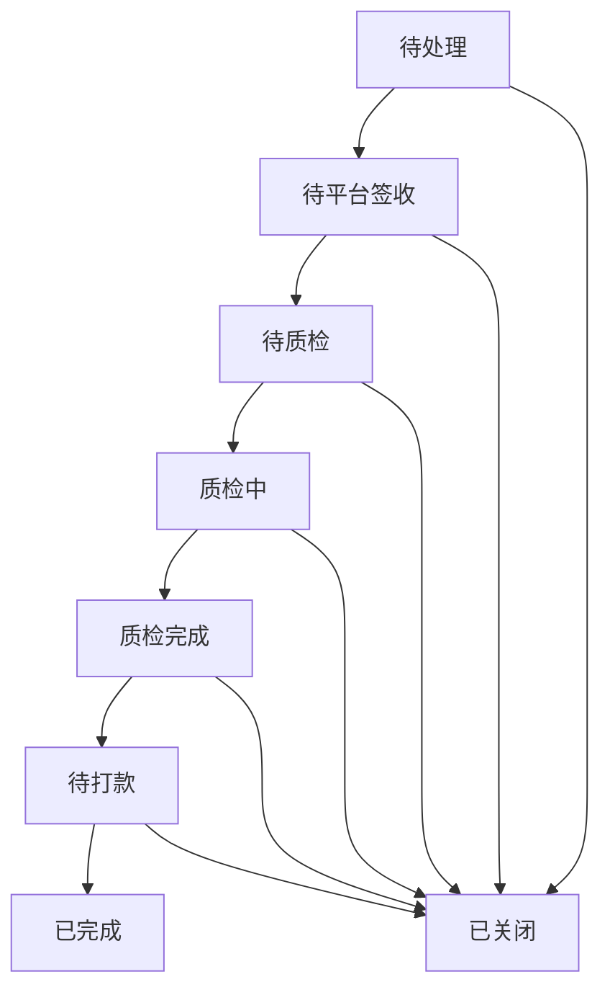

# 手机回收价格插件

## PC 跨系统操作日志

「回收 → 业务 → 操作日志」默认按发生时间显示本店记录，不需要先搜单号。可按回收、ERP、博远筛选并查看操作人、结果、单号和关联单据。回收订单详情内的「业务操作日志 · 本单」只看这笔业务；独立 ERP/博远业务不挂到无关回收单。查阅需要单独的站点后台菜单权限，不提供会员接口。

已有安装手工更新代码时，在框架目录先执行 `php addon/hsx_recycle/scripts/upgrade_business_audit.php --check` 查看升级，再在维护窗口执行 `--apply`，刷新回收菜单（`php think menu:refresh --addon=hsx_recycle`），并构建 PC 管理端。升级只加可空字段和日志索引、兼容 MySQL 5.7/8，不建新表、不补写历史数据；正常新装已包含这些结构。建议在多实例环境先完成结构升级再切换生产代码与队列。

原始回收记录继续从订单/设备日志读取；新 ERP、博远摘要追加到 `recycle_order_log`。业务单、设备的关联必须来自同站点的真实外键。同一事件按稳定标识去重，跨多个回收订单时全站列表只显示一条，打开各自原单仍能看见与它有关的记录。原始收发报文仍由博远插件通过 PHP Log 保存；未找到历史报文不能视为未发过请求，收到响应不证明已核销。不要因为日志缺失重新开单或付款。

## 订单状态说明

订单状态使用统一的数字状态码，具体如下：

| 状态码 | 状态名称 | 说明 |
|--------|----------|------|
| 0 | 待处理 | 订单初始状态 |
| 1 | 待平台签收 | 等待平台确认签收设备 |
| 2 | 待质检 | 设备已签收，等待开始质检 |
| 3 | 质检中 | 正在进行设备质检 |
| 4 | 质检完成 | 设备质检已完成 |
| 5 | 待打款 | 等待向用户支付款项 |
| 6 | 已完成 | 订单已完成 |
| -1 | 已关闭 | 订单已关闭（包含取消、退回等终止状态） |

## 状态流转说明

订单状态按以下流程进行流转：



## 接口说明

### 字典接口

获取订单状态字典：
- 请求方式：GET
- 接口路径：`/dict/recycle_order`
- 返回示例：
```json
{
    "code": 0,
    "msg": "success",
    "data": {
        "0": {
            "name": "待处理",
            "status": 0,
            "action": ["confirm", "close"]
        },
        "1": {
            "name": "待平台签收",
            "status": 1,
            "action": ["confirm", "close"]
        }
        // ... 其他状态
    }
}
```

## 更新日志

### 2025-02-23
- 统一订单状态定义，使用数字状态码
- 添加字典接口，统一状态管理
- 优化状态流转逻辑，简化状态处理
- 合并取消和退回状态为统一的"已关闭"状态
